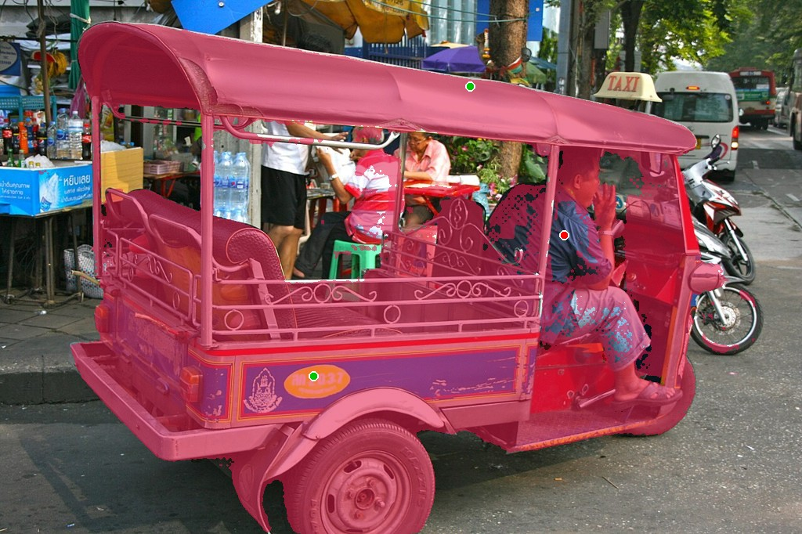
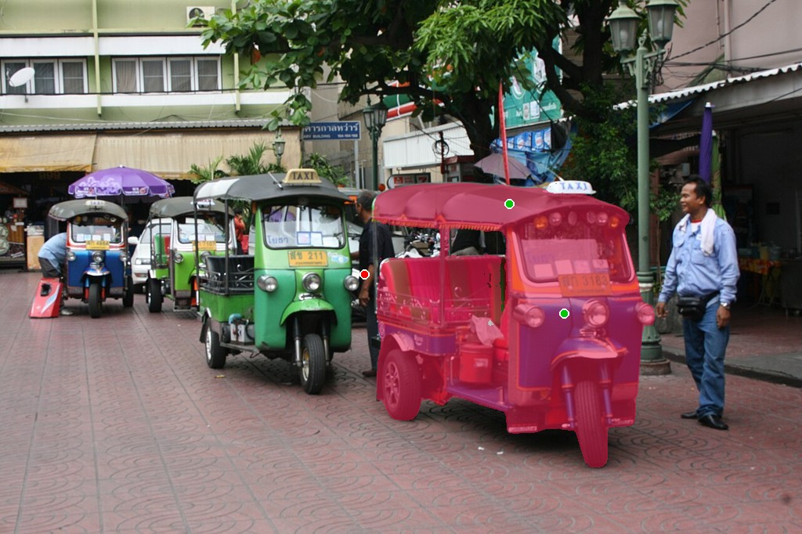
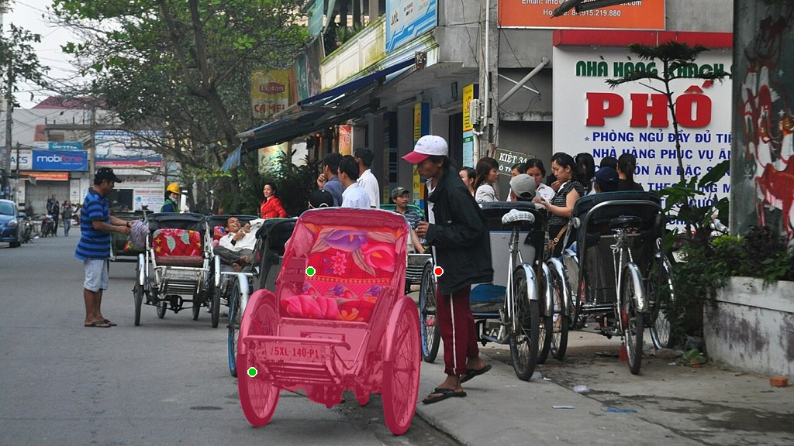

# Label contract — Phố châu Á — BỔ SUNG v1.1 — 2A202603215 - Nguyễn Gia Huy

Đây là phần bổ sung sau khi thử model, review batch và kiểm ba mask SAM. Các mục không nêu dưới đây tiếp tục áp dụng theo v1.0. Tôi giữ nguyên tên lớp, thuộc tính và các ngưỡng trong `submission/taxonomy.json`.

## 1. Câu hỏi mở đã chốt (từ mục 6 của v1.0)

| # | Câu hỏi | Quyết định | Ảnh ví dụ | `case_id` |
|---|---|---|---|---|
| 5 | Kính xe nhìn xuyên qua có thuộc mask xe không? | Có, giữ bề mặt kính gắn trên xe trong mask xe. Phân biệt kính với khoảng hở không có kính: người hoặc nền nhìn qua khoảng hở không thuộc mask xe. | img_013 | CAL-02 |
| 7 | Có mức tin cậy nào cho phép chấp nhận box mà không cần sửa hoặc kiểm tra không? | Không dùng `conf` để bỏ qua kiểm tra ảnh. Ngưỡng Part 3 chỉ lọc ứng viên pre-label; chấp nhận sau review còn phải đúng vật, đúng lớp và đúng hình học. | img_011, img_002 | CAL-03 |

### Làm rõ câu hỏi 5 — kính và khoang hở

- Kính chắn gió hoặc cửa kính gắn trên xe là một phần của xe. Giữ vùng bề mặt kính trong mask, không khoét chỉ vì nhìn thấy nội thất hay người phía sau kính.
- Khoang hành khách hở hoặc cạnh xe không có kính không phải bề mặt kính. Chỉ giữ khung xe, ghế và các phần xe nhìn thấy; loại người hoặc nền trong khoảng hở. Với `img_013`, phần người lái và người phía sau còn bị tô trong mask là phần cần kiểm lại.
- Phần người được nhìn thấy qua kính vẫn được xét để gán box `person` theo v1.0. Đối với mask phần nhìn thấy, vùng được xác định là bề mặt kính thuộc mask xe; không tạo thêm mask người chồng lên cùng bề mặt đó. Phần người nhìn trực tiếp qua khoang hở thuộc mask người, không thuộc mask xe.

### Làm rõ câu hỏi 7 — điểm cao vẫn phải kiểm

- `img_011`: YOLO26 gán tuk-tuk sát mép trái thành `truck` với conf khoảng 0,77. YOLOE nhận xe này là `three_wheeler` với conf khoảng 0,28. Điểm cao không bảo đảm đúng lớp; điểm thấp cũng không đủ để kết luận là box thừa.
- `img_002`: xe bán tải trắng bị YOLO26 gán `truck` với conf khoảng 0,73, trong khi v1.0 xếp bán tải vào `car`.
- Ảnh đối chiếu: [img_011](../../data/images/img_011.jpg), [img_002](../../data/images/img_002.jpg). Nhãn và điểm của từng lượt được ghi trong `model_log.csv`, các dòng `r01` và `r03`.
- Vẫn áp dụng bước quét ảnh trước, rồi kiểm bỏ sót, thừa, sai lớp và biên box. Chỉ giữ nguyên box khi đã đối chiếu với ảnh và guideline, không chấp nhận tự động dựa trên `conf`.
- Ngưỡng tạo ứng viên không thay đổi: `person=0.35`, `bicycle=0.2`, `motorbike=0.5`, `three_wheeler=0.15`; `car`, `bus`, `truck` dùng mặc định `0.3`. Các giá trị này lấy từ Part 3, không phải ngưỡng miễn review.

### Các câu hỏi chưa chốt thêm trong v1.1

| # | Nội dung | Trạng thái và cách xử lý hiện tại |
|---|---|---|
| 1 | Xe đạp điện và xe máy điện | Chưa có ca được xác minh đủ rõ trong các ví dụ calibration này. Không suy đoán loại động cơ chỉ từ dáng xe; nếu gặp ca chưa rõ thì dùng `can_review` và ghi lại để chốt. |
| 2 | Cụm xe máy dày ở gần camera | Chưa bổ sung ngưỡng mới cho cụm gần. Tiếp tục gán từng xe rõ theo v1.0, không dùng `ignore_region` chỉ vì nhiều xe hoặc tốn thời gian. Ca không tách được từng vật cần được ghi lại để quyết định. |
| 3 | Hàng hoá nhô ra khỏi xe | Chưa có phép đối chiếu riêng cho hàng nhô ra trong ba lượt mask. Giữ quy tắc box của v1.0; chưa tự mở rộng sang một quy tắc mask mới cho mọi loại hàng. |
| 4 | Ngưỡng phần người còn nhìn thấy | Giữ ngưỡng 20% của v1.0. Chưa có kiểm tra độc lập để khẳng định độ nhất quán khi ước lượng bằng mắt; ca sát ngưỡng vẫn cần review. |
| 6 | Box chồng nhau trong ảnh đêm | Chưa có ca ảnh đêm được phân tích riêng trong bảng quyết định này. Không tự gộp các vật khác nhau; cần xem lại ảnh cụ thể trước khi đặt quy tắc bổ sung. |

Các mục trên không được coi là đã giải quyết chỉ vì đã có bản v1.1. Nếu phát sinh ca chưa có quy tắc đủ rõ trong mẫu QC thì ghi nhận guideline gap và xử lý khi ra quyết định QC.

## 2. Ca khó mới (từ lỗi của máy, bẫy lọt, box `can_review`)

| Ảnh | Tình huống | Máy làm gì (model nào) | Quyết định của bạn | Quy tắc mới (vào mục nào của v1.0) |
|---|---|---|---|---|
| img_004, img_013 | Tuk-tuk bị gọi là ô tô | YOLO26 gán `car`; SAM vẫn giữ lớp từ detector. | Giữ `three_wheeler` theo v1.0; dùng YOLOE bổ sung ứng viên và kiểm bằng hình xe. | CAL-01: bổ sung ví dụ cho mục 2, không đổi định nghĩa lớp. |
| img_013, img_004 | Mask dính người hoặc thiếu bộ phận gắn trên xe | SAM 2.1 tô vào người lái ở img_013; bỏ biển TAXI trên mái ở img_004. | Kiểm tách người và xe, đồng thời rà đủ bộ phận gắn cố định; mask còn lỗi phải sửa trước khi dùng như nhãn đã đạt. | CAL-04: bổ sung bước kiểm cho mục 4.2; giữ nguyên nguyên tắc phần nhìn thấy và không chồng mask. |
| img_032 | Khoảng trống trong khung xích lô bị tô | SAM 2.1 trả một polygon, còn tô kín một số khoảng hở trong khung. | Kiểm từng lỗ theo ngưỡng xấp xỉ 5% đã có; chưa đo thì không kết luận mọi khoảng hở đều phải loại. | CAL-05: thêm ví dụ cho mục 4.2.2; không đổi ngưỡng. |

### CAL-01 — nhầm lớp là lỗi máy

Tuk-tuk có mái hoặc có người lái vẫn thuộc `three_wheeler`. Không chuyển sang `car` hay `truck` để khớp nhãn máy. Người nhìn thấy đủ điều kiện vẫn có nhãn riêng. Ca này dùng để nhắc lại quy tắc đã có, không tạo một lớp hay định nghĩa mới.

### CAL-04 — rà mask theo từng phần

1. Rà phần xe nhìn thấy: mái, thân, bánh, khung và các bộ phận gắn cố định. Biển TAXI gắn trên mái ở `img_004` được xét là bộ phận xe, không phải nền.
2. Rà người lái, hành khách và người đứng sát xe. Các phần người nhìn trực tiếp phải được loại khỏi mask xe; ở vùng che khuất chỉ giữ phần xe thực sự nhìn thấy.
3. Nếu mask còn dính người hoặc thiếu bộ phận, thử thêm click dương/âm hoặc sửa biên. Việc có kết quả mask không thay thế bước kiểm tra chất lượng.

### CAL-05 — rà khoảng trống trong khung

Giữ quy tắc v1.0: khoảng trống nhỏ hơn xấp xỉ 5% diện tích vật có thể không khoét, khoảng trống lớn phải được loại. Không dùng số polygon để kết luận mask đã đạt; một polygon vẫn có thể tô vào vùng nền nhìn xuyên khung. Với `img_032`, cần kiểm diện tích các khoảng hở trước khi chấp nhận hoặc sửa. Bản này chưa đưa ra số đo diện tích từng lỗ.

Ba ảnh mask được giữ làm bằng chứng quan sát, không được mô tả là đã sửa sạch theo các quyết định trên. Các bổ sung không tự động sửa nhãn trong CVAT; thay đổi nào làm đổi nhãn phải được kiểm lại và export đúng quy trình.

### CAL-06 — ca phát sinh trong QC, chưa chốt

Ở [img_008](../../data/images/img_008.jpg), các xe đẩy bán trái cây có box `three_wheeler` #85, #87 và #88. Ảnh cho thấy các bánh lớn ở hai bên, nhưng chưa đủ để xác nhận cấu trúc ba bánh của từng xe hoặc thống nhất việc xe đẩy tay bán hàng có thuộc phạm vi lớp này không.

Ca này được ghi là còn mở, không dùng để tự đổi taxonomy hay kết luận cả ba box đều sai lớp. Cần xác minh cấu trúc xe và chốt phạm vi áp dụng: xe ba bánh được xác nhận thì giữ `three_wheeler`; xe đẩy hai bánh nằm ngoài các lớp mục tiêu thì không gán lớp này. Nếu chưa xác minh được thì tiếp tục giữ ca để làm rõ. Đây là 1 guideline gap trong vòng QC hiện tại, dẫn đến quyết định Hold.

## 3. Lịch sử thay đổi

| Phiên bản | Thay đổi | Lý do (ca nào, `case_id`) |
|---|---|---|
| v1.0 | Bản giảng viên | — |
| v1.1 | Bổ sung ví dụ nhầm lớp tuk-tuk; giữ định nghĩa lớp. | img_004, img_013; CAL-01 |
| v1.1 | Làm rõ bề mặt kính và khoảng hở trong mask xe. | img_013; CAL-02 |
| v1.1 | Chốt rằng conf không phải tiêu chí miễn review. | img_011, img_002; CAL-03 |
| v1.1 | Bổ sung kiểm tách người, bộ phận gắn cố định và khoảng trống trong mask. | img_013, img_004, img_032; CAL-04, CAL-05 |
| v1.1 | Ghi nhận ca xe đẩy bán hàng còn mở trong QC; chưa thay định nghĩa lớp. | img_008; CAL-06 |
